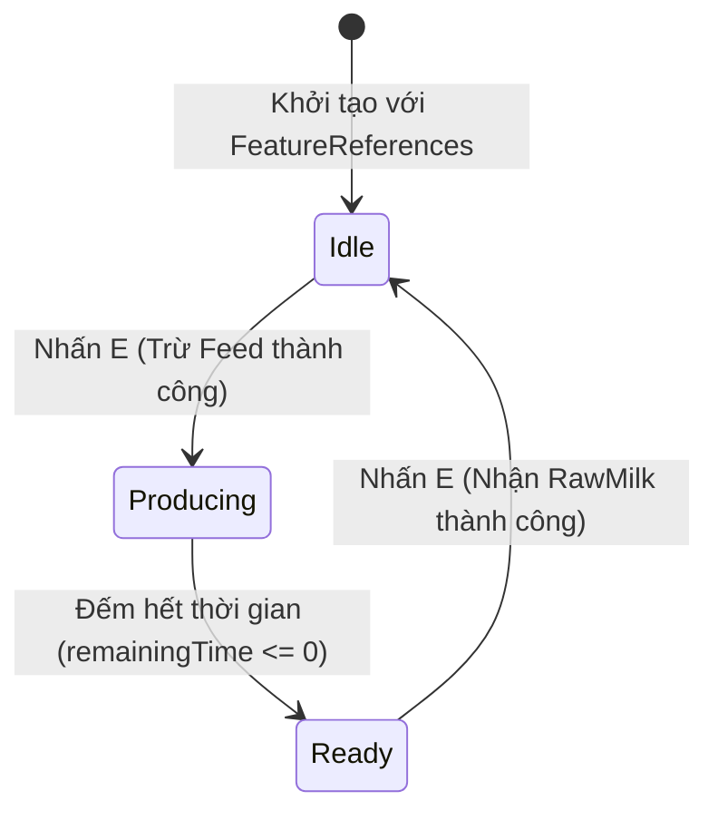
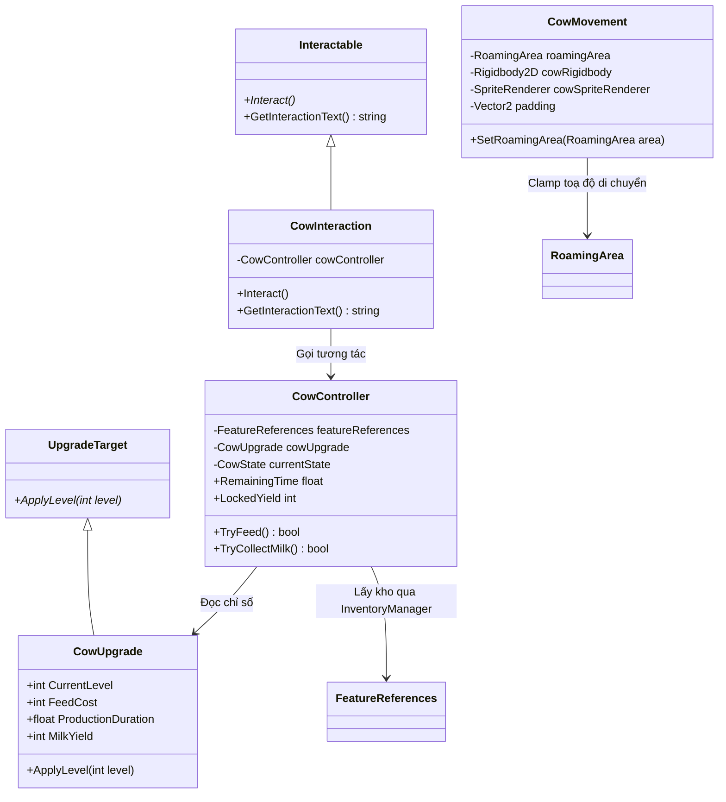

# Tài Liệu Bàn Giao Tính Năng: Bò Sữa (Cows Feature)

> **Nhánh thực hiện:** `feature/cows`  
> **Scene kiểm thử:** `Assets/_Game/Scenes/Tests/CowTest.unity`  
> **Thư mục mã nguồn:** `Assets/_Game/Scripts/Features/Cows/`  
> **Thư mục prefab bàn giao:** `Assets/_Game/Prefabs/Features/Cows/`

Tài liệu này tổng hợp toàn bộ thiết kế, cách thức hoạt động, hướng dẫn thử nghiệm và quy trình ghép tích hợp tính năng **Bò sữa (Cows)** dành cho các thành viên trong nhóm (Reviewer, người phụ trách Base / Main, và người làm tính năng Xây dựng / Building).

---

## 1. Tổng Quan Tính Năng & Vòng Lặp Trò Chơi (Core Loop)

Tính năng Cows là mắt xích đầu tiên tạo ra sản phẩm thô trong chuỗi cung ứng của PolishCow:
$$\text{Credits} \xrightarrow{\text{Mua Feed}} \text{Feed} \xrightarrow[\text{Chăm bò (Cows)}]{\text{Cho ăn \& Đếm giờ}} \mathbf{RawMilk} \xrightarrow{\text{Đóng chai (Production)}} \text{BottledMilk} \xrightarrow{\text{Đơn hàng (Orders)}} \text{Credits}$$

### Trạng thái vòng đời của Bò (`CowState`)
Bò hoạt động như một máy trạng thái (State Machine) 3 bước khép kín:


1. **Idle (Đang đói / Chờ ăn)**:
   - Gợi ý tương tác: `Nhấn E: Cho bò ăn (1 Feed)`.
   - Người chơi nhấn E $\rightarrow$ Hệ thống kiểm tra kho: nếu đủ Feed $\rightarrow$ trừ Feed, chốt thông số lượt nuôi và chuyển sang `Producing`.
2. **Producing (Đang nhai cỏ & tạo sữa)**:
   - Gợi ý tương tác: `Nhấn E: Đang tạo sữa (Xs)`.
   - Bò đếm ngược thời gian. Bấm E liên tục lúc này không bị trừ thêm Feed (chống spam).
3. **Ready (Sữa đã sẵn sàng thu hoạch)**:
   - Gợi ý tương tác: `Nhấn E: Thu hoạch sữa (+X RawMilk)`.
   - Người chơi nhấn E $\rightarrow$ Hệ thống cộng `RawMilk` vào kho $\rightarrow$ Chuyển về `Idle`.

---

## 2. Kiến Trúc Mã Nguồn (Architecture & Classes)

Toàn bộ script nằm trong `Assets/_Game/Scripts/Features/Cows/`:

```text
Assets/_Game/Scripts/Features/Cows/
├── CowUpgrade.cs        # Kế thừa UpgradeTarget (xử lý nâng cấp cấp tuyệt đối 1..3)
├── CowMovement.cs       # Tuần tra ngẫu nhiên, kẹp biên RoamingArea, lật sprite
├── CowController.cs     # State Machine, chốt lượt nuôi, giao dịch với InventoryManager
└── CowInteraction.cs    # Kế thừa Interactable, bắt phím E và cập nhật HUD động
```



### Chi tiết các lớp:

### 2.1. `CowUpgrade.cs` (Kế thừa `UpgradeTarget`)
- **Nguyên tắc Idempotent**: `ApplyLevel(int level)` nhận cấp tuyệt đối ($1 \le level \le 3$). Gọi cấp 2 hai lần vẫn cho ra cùng chỉ số cấp 2 (không bao giờ dùng `level++` hay nhân dồn).
- **Bảng chỉ số chuẩn hóa** (theo `TEAM_GUIDE.md` mục 6):
  | Cấp độ | Thời gian sản xuất | Sản lượng (RawMilk) | Tiêu hao (Feed) |
  |:---:|:---:|:---:|:---:|
  | **Cấp 1** | $10.0\text{s}$ ($\times 1.0$) | $1$ ($\times 1$) | $1$ |
  | **Cấp 2** | $8.0\text{s}$ ($\times 0.8$) | $1$ ($\times 1$) | $1$ |
  | **Cấp 3** | $6.0\text{s}$ ($\times 0.6$) | $2$ ($\times 2$) | $1$ |

### 2.2. `CowMovement.cs`
- **Di chuyển tuần tra**: Điểm đích được lấy ngẫu nhiên qua `roamingArea.GetRandomPoint(padding)`. Sau mỗi chặng đi dạo, bò dừng lại nghỉ ngơi ngẫu nhiên từ $2\text{s}$ đến $5\text{s}$.
- **Kẹp biên an toàn**: Mỗi bước `FixedUpdate` đều được kẹp toạ độ bằng `roamingArea.ClampPosition(nextPosition, padding)` với `padding = (0.35f, 0.4f)` (được tính toán chính xác từ nửa kích thước collider $0.7/2$ và độ lệch tâm $-0.2$). Bò **không bao giờ vượt ra ngoài vùng `RoamingArea`**.
- **Hướng mặt**: Tự động lật `flipX` của `SpriteRenderer` theo chiều di chuyển trục X.

### 2.3. `CowController.cs`
- **Không dùng Singleton / Find**: Kho luôn được lấy thông qua `featureReferences.Inventory`. Nếu chưa được Initialize, script từ chối chạy để bảo vệ toàn vẹn dữ liệu.
- **Khóa lượt nuôi (Cycle Lock)**: Khi cho ăn thành công, các thông số `lockedDuration`, `remainingTime`, `lockedYield` được chốt cố định cho chu kỳ đó. Nếu người chơi nâng cấp chuồng bò trong khi bò đang tạo sữa, **lượt hiện tại giữ nguyên, chỉ lượt tiếp theo mới hưởng thời gian nhanh hơn**.
- **Chống tràn số (Int Overflow Check)**: Kiểm tra `inventory.GetAmount(ItemType.RawMilk) > int.MaxValue - lockedYield` trước khi thêm vào kho.

### 2.4. `CowInteraction.cs` (Kế thừa `Interactable`)
- Override `Interact()`: Tự động điều phối gọi `TryFeed()` khi `Idle` hoặc `TryCollectMilk()` khi `Ready`.
- **Gợi ý ngữ cảnh thời gian thực**: Cập nhật trực tiếp nội dung gợi ý lên `InteractionHint` của Player mà không cần can thiệp hay sửa đổi lớp `Interactable` gốc.

---

## 3. Cấu Trúc Prefab Bàn Giao (`CowBarn.prefab`)

Được thiết kế đóng gói độc lập theo đúng quy chuẩn hợp đồng kỹ thuật tại `TEAM_GUIDE.md`:

```text
CowBarn.prefab (Gốc công trình)
├── FeatureReferences                <-- Dành cho hệ thống Base / Building truyền kho vào
├── CowUpgrade                       <-- Kế thừa UpgradeTarget (Building gọi ApplyLevel)
│
├── Visual (Hiển thị đồ họa chuồng trại)
│   ├── SpriteRenderer (Sprite chuồng/hàng rào)
│   └── WorldDepthSorting (feetOffsetY)
│
├── RoamingArea (Vùng giới hạn di chuyển - ĐỨNG YÊN, KHÔNG LÀM CON CỦA BÒ)
│   └── RoamingArea (size=(5, 4), centerOffset=(0, -1.5))
│
└── Cow (Đối tượng con đại diện cho bò)
    ├── SpriteRenderer (Sprite bò)
    ├── WorldDepthSorting (feetOffsetY = -0.2)
    ├── BoxCollider2D (offset=(0, -0.2), size=(0.7, 0.4))
    ├── Rigidbody2D (Kinematic, 0 gravity, freezeRotation)
    ├── CowMovement (roamingArea -> trỏ tới RoamingArea con ở trên)
    ├── CowController (featureReferences -> trỏ tới FeatureReferences ở gốc)
    │                 (cowUpgrade -> trỏ tới CowUpgrade ở gốc)
    ├── CowInteraction (cowController -> trỏ tới CowController bên cạnh)
    └── InteractionPoint
```

> [!TIP]
> **Ưu điểm kiến trúc:**  
> - Người làm hệ thống **Xây dựng (Building)** chỉ cần `Instantiate(cowBarnPrefab)` rồi gọi:  
>   `instance.GetComponent<FeatureReferences>().Initialize(inventory);`  
>   `instance.GetComponent<UpgradeTarget>().ApplyLevel(targetLevel);`  
> - Mọi liên kết nội bộ giữa Bò, Vùng di chuyển và Chỉ số chuồng trại đều tự động khép kín!

---

## 4. Hướng Dẫn Thử Nghiệm & Xác Nhận (Testing Guide)

### Cách 1: Thiết lập tự động qua Unity Editor Menu
1. Mở Unity Editor với dự án `PRU213-ASM`.
2. Trên thanh menu trên cùng, chọn:  
   **`Tools → PolishCow → Setup Cows Feature (Prefabs & Scene)`**  
   *(Editor script sẽ tự động tạo `CowBarn.prefab` và gán đầy đủ component vào `CowSample` trong scene `CowTest.unity`)*.

### Cách 2: Kiểm thử thủ công trên scene `CowTest.unity`
1. Mở scene `Assets/_Game/Scenes/Tests/CowTest.unity`.
2. Đảm bảo kho ban đầu có ít nhất 1 Feed (mặc định sau khi chạy setup base là `Feed = 20`).
3. Nhấn **Play** và thực hiện kịch bản:

| Bước kiểm thử | Thao tác | Hiện tượng kỳ vọng |
|---|---|---|
| **1. Tiếp cận** | Di chuyển Player lại gần con bò | HUD góc màn hình hiện: `Nhấn E: Cho bò ăn (1 Feed)`. Đi ra xa $\rightarrow$ HUD ẩn đi. |
| **2. Cho ăn** | Nhấn phím **E** một lần | `Feed` trên HUD giảm từ 20 xuống 19. HUD đổi sang đếm ngược: `Nhấn E: Đang tạo sữa (10s)`. Bò chuyển sang trạng thái nhai cỏ. |
| **3. Chống spam E** | Nhấn **E** liên tục nhiều lần lúc đang tạo sữa | Không bị trừ thêm Feed, không sinh lỗi đỏ Console. Số giây tiếp tục đếm lùi đều đặn. |
| **4. Thu hoạch** | Chờ hết 10 giây | HUD đổi thành: `Nhấn E: Thu hoạch sữa (+1 RawMilk)`. |
| **5. Nhận sữa** | Nhấn phím **E** | `RawMilk` trên HUD tăng lên 1. HUD chuyển về: `Cho bò ăn`. Bò trở lại trạng thái Idle. |
| **6. Thiếu Feed** | Dùng hết Feed về 0 và nhấn **E** | Bò không bắt đầu chu kỳ, không trừ âm Feed. |
| **7. Vùng đi (Roaming)** | Quan sát bò di chuyển 2-3 phút | Bò đi dạo và nghỉ ngơi tự nhiên; chân và thân bò luôn nằm hoàn toàn trong khung viền Cyan của `RoamingArea`, không bị lọt ra ngoài. |
| **8. Nâng cấp cấp 2** | Chỉnh `Current Level = 2` trên `CowUpgrade` | Lượt tiếp theo thời gian sản xuất chỉ còn 8 giây. |
| **9. Nâng cấp cấp 3** | Chỉnh `Current Level = 3` trên `CowUpgrade` | Lượt tiếp theo thời gian sản xuất giảm còn 6 giây và thu hoạch được 2 RawMilk. |

---

## 5. Hướng Dẫn Ghép Main (Dành Cho Người Phụ Trách Base / Tích Hợp)

Khi tích hợp `CowBarn.prefab` vào `Assets/_Game/Scenes/Main.unity`:

1. Kéo `CowBarn.prefab` từ `Assets/_Game/Prefabs/Features/Cows/` vào scene `Main.unity` (đặt tại vị trí chuồng bò mong muốn).
2. Chọn đối tượng `FeatureReferenceInitializer` trong scene `Main`:
   - Thêm component `FeatureReferences` ở gốc của `CowBarn` vào danh sách `Features`.
3. Kiểm tra Layer & Collider:
   - Đảm bảo Layer của `Cow` nằm trong LayerMask tương tác của `PlayerInteraction` (mặc định là `Everything` / `~0`).
4. Không xóa hay sửa đổi các script dùng chung (`Core/`, `Inventory/`, `Interaction/`).

---

## 6. Mẫu Nội Dung Mở Pull Request (PR Template)

*(Khi hoàn thành và đẩy nhánh `feature/cows` lên GitHub, copy mẫu bên dưới vào mô tả PR)*:

```markdown
### Đã làm:
- Hoàn thành module Cows gồm 4 script:
  + `CowUpgrade.cs`: Nâng cấp chuồng bò 3 cấp theo cấp tuyệt đối (idempotent), khóa chỉ số theo lượt.
  + `CowMovement.cs`: Di chuyển tuần tra và kẹp biên an toàn trong RoamingArea (padding 0.35, 0.4), lật sprite 2 hướng.
  + `CowController.cs`: Quản lý State Machine (Idle -> Producing -> Ready), trừ Feed và cộng RawMilk qua InventoryManager, chống tràn số.
  + `CowInteraction.cs`: Kế thừa Interactable, hiển thị gợi ý ngữ cảnh động theo trạng thái trên HUD, chống spam phím E.
- Đóng gói prefab bàn giao `CowBarn.prefab` (chứa FeatureReferences, CowUpgrade, RoamingArea cố định và đối tượng Cow).
- Tạo công cụ Editor `PolishCowCowsSetup.cs` hỗ trợ 1-click setup prefab & scene CowTest.

### Cách thử:
- Mở `Assets/_Game/Scenes/Tests/CowTest.unity`, nhấn Play.
- Đến gần bò nhấn E để cho ăn (tốn 1 Feed). Chờ đếm ngược 10s nhấn E để thu hoạch 1 RawMilk.
- Thử spam phím E lúc đang nuôi -> không bị trừ trùng.
- Thử đổi cấp độ CowUpgrade lên cấp 2 (8s) và cấp 3 (6s, 2 sữa) -> hoạt động chính xác.

### Khi ghép Main:
- Kéo `CowBarn.prefab` vào `Main.unity`.
- Thêm `FeatureReferences` ở gốc CowBarn vào mảng `Features` của `FeatureReferenceInitializer`.

### Đã kiểm tra:
- Build code: `dotnet build Assembly-CSharp.csproj` đạt 0 Warning, 0 Error.
- Kiểm tra hợp đồng: Đúng chuẩn RoamingArea, UpgradeTarget và FeatureReferences.

### Còn thiếu:
- Hiện tại dùng sprite mặc định trong bộ asset có sẵn; nếu có sprite animation ăn cỏ/nhai cỏ chuyên dụng sẽ bổ sung thêm Animator ở đợt cập nhật Art sau.
```
